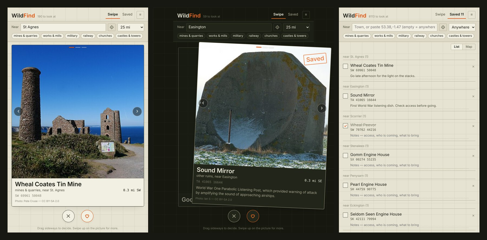
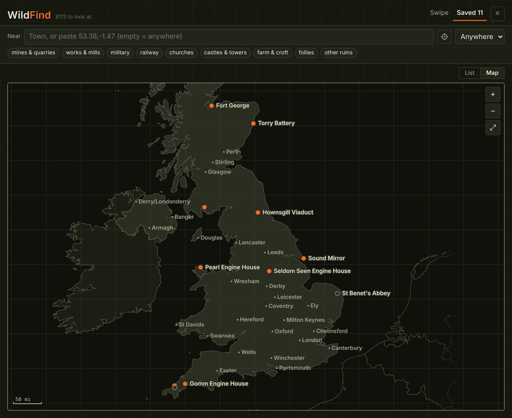
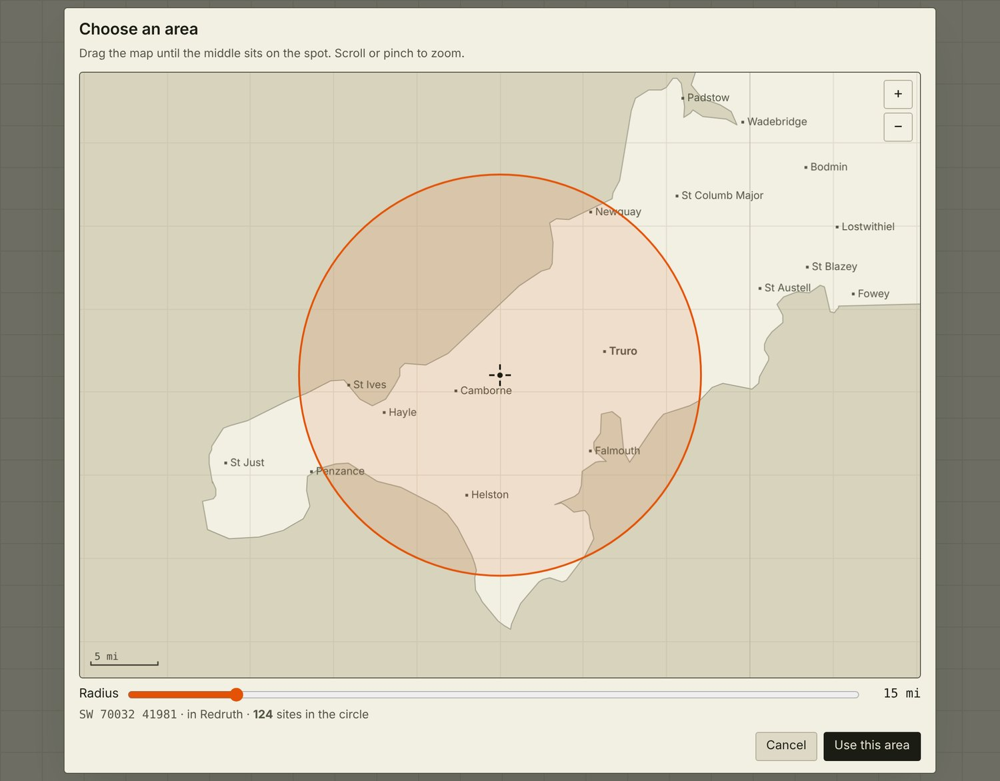

# WildFind

**Swipe through abandoned places in the UK. Works with no internet.**

Mines, forts, viaducts, engine houses and ruined abbeys, one card at a time. Swipe right to save a place, left to hide it for good, then plan a day out from your shortlist. Everything runs from one HTML file on your own machine.



- **84,363 sites** across the UK and the Isle of Man, from OpenStreetMap
- **8,124 sites with real photographs**, about 17,800 photos from Wikimedia Commons
- **Fully offline:** no server, account, tracking or install

## Features

- **Swipe deck:** drag, use the buttons or use the arrow keys. Step through a site's photographs without making a decision.
- **Near and distance:** type a town, paste coordinates or choose an area on the map.
- **Kind filters:** mines and quarries, works and mills, military, railway, churches, castles and towers, farms, follies and other ruins.
- **Saved list:** tick places off, add notes and see which sites are near each other.
- **Offline maps:** saved sites are pinned on a British National Grid map, drawn without map tiles.
- **Backups:** save your list to a JSON file and load it on another machine.
- **Light and dark themes.**



*The saved map, with no internet connection needed.*



*Drag the map and set a radius to choose where to look.*

## Getting started

1. Download or clone this repository.
2. Double-click `WildFind.html`. It opens in your browser, with the full site list ready to use.

The photographs are too big for Git, so a fresh copy shows a labelled sketch of each kind of structure. To download them, install Python 3.9 or newer on Windows and run:

```
tools\FETCH DATA.bat
```

This rebuilds the site list and downloads the photographs. It takes about half a day, needs about 11 GB free while it runs, and carries on where it stopped if you interrupt it.

[`GUIDE.txt`](GUIDE.txt) has the full instructions and troubleshooting.

## How the data is gathered

The fetcher uses bulk downloads and does its matching locally, so it doesn't lean on services meant for people:

- **Sites:** Geofabrik's nightly OpenStreetMap extract, filtered with pyosmium, instead of thousands of live queries.
- **Photo locations:** one Wikimedia Commons location dump, matched against the sites on your machine.
- **Photo checks:** a photo is kept only if its title names the site. An early sample showed about half of the merely nearby photos were off-topic.
- **Downloads:** one image at a time, slowing down when the servers do and backing off if asked.

## Project layout

| Path | What it is |
| --- | --- |
| `WildFind.html` | The whole app: HTML, CSS and JavaScript, with no build step |
| `data/` | Generated sites, towns, photo index and coastline |
| `tools/` | The data fetcher (Python and PowerShell) |
| `tests/` | Fetcher tests, using local fake servers: `python tests/run_all.py` |
| `GUIDE.txt` | Using the app, and troubleshooting |
| `NOTES.md` | How it all works, for developers |

## Before you go anywhere

A position on a map is not permission to be there, or a sign that a place is safe. Most of these sites are on private land. Mines and quarries can have bad air, flooded levels, rotten floors and old explosives, and derelict buildings can bring asbestos and collapse. Check access and tell someone where you are going.

## Credits

- **Sites and towns:** © [OpenStreetMap](https://www.openstreetmap.org/copyright) contributors, Open Database Licence.
- **Photographs:** [Wikimedia Commons](https://commons.wikimedia.org), mostly from Geograph. Each card shows its photo's author and licence, and the fetcher writes the full list to `ATTRIBUTION.txt`.
- **Coastline:** [Natural Earth](https://www.naturalearthdata.com), public domain.

**Photos in the screenshots**, both [CC BY-SA 2.0](https://creativecommons.org/licenses/by-sa/2.0/):

- Wheal Coates Tin Mine: [Pete Cruse](https://commons.wikimedia.org/wiki/File:Wheal_Coates_disused_mine_workings_-_geograph.org.uk_-_8010316.jpg)
- Sound Mirror: [Ian S](https://commons.wikimedia.org/wiki/File:A_Sound_Mirror_from_the_First_World_War_-_geograph.org.uk_-_2200742.jpg)

`images/overview.jpg` contains these photos and is shared under the same licence.
